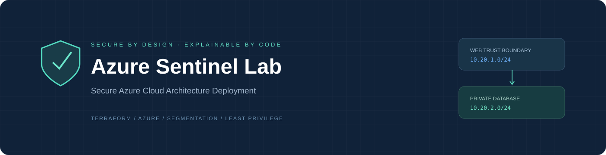
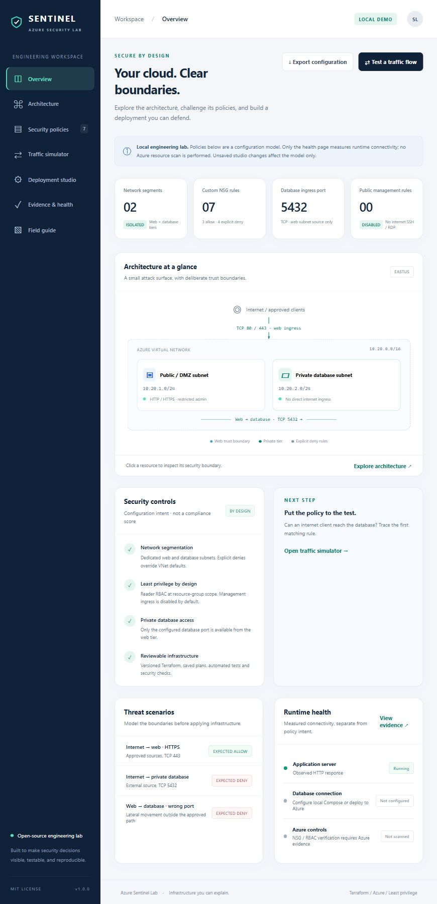
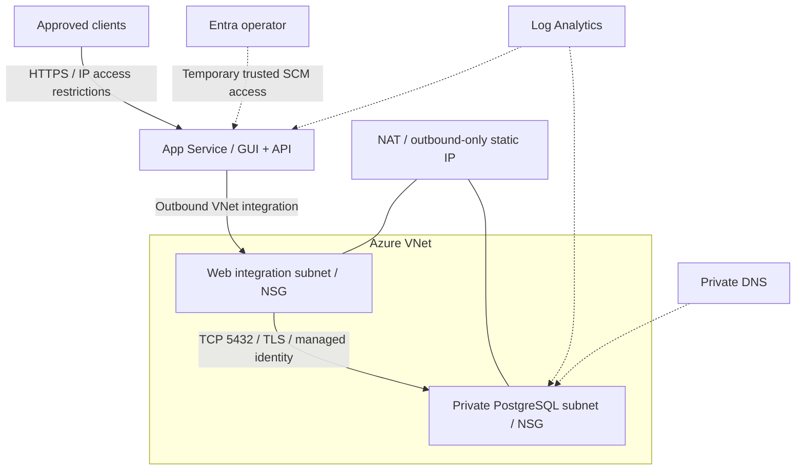

<p align="center"></p>

# Azure Sentinel Lab

**Secure Azure Cloud Architecture Deployment · Infrastructure as Code + Security Workbench**

[](https://github.com/Dahyuel/secure-azure-cloud-architecture/actions/workflows/ci.yml)
[](https://github.com/Dahyuel/secure-azure-cloud-architecture/actions/workflows/security.yml)
[](LICENSE)

A complete, runnable cloud-security portfolio project: an interactive GUI, a tested Node.js backend, an isolated local PostgreSQL stack, and Terraform for a segmented Azure deployment. Explore trust boundaries, explain firewall decisions, prepare validated configuration, and distinguish design intent from observed evidence.

[Architecture](docs/ARCHITECTURE.md) · [Azure deployment](docs/DEPLOYMENT.md) · [Threat model](docs/THREAT_MODEL.md) · [Operations](docs/OPERATIONS.md) · [Validation](docs/VALIDATION.md) · [Security policy](SECURITY.md)

## Features

- **GUI:** seven responsive views: overview, interactive topology, searchable policies, traffic simulator, deployment studio, evidence/health, and engineering field guide.
- **Network:** two trust zones, explicit default-deny NSGs, a single web-to-database port, and optional restricted management in the baseline VM-network profile.
- **Azure workloads:** managed HTTPS App Service, private PostgreSQL Flexible Server, private DNS, verified database TLS, Entra-only authentication and explicit NAT egress.
- **Least privilege:** resource-group Reader RBAC, a system-assigned application identity and an operator-created CONNECT-only database login.
- **DevSecOps:** application/API tests, Terraform mock tests, Docker integration checks in CI, dependency/secret scans, IaC review reports, Dependabot and credential-free application packaging.
- **Operations:** centralized Azure diagnostics, database CPU alert, backup retention, recovery runbook, threat model, architectural decisions and evidence template.

This is a professional reference implementation with a documented acceptance process. It does not claim audited compliance, proven availability or a completed live Azure deployment. No scholarship affiliation or endorsement is implied.

## Quick start

Install Node.js 22 LTS or newer supported by `package.json`, then run from the repository root:

```sh
git clone https://github.com/Dahyuel/secure-azure-cloud-architecture.git
cd secure-azure-cloud-architecture
npm ci
npm run check
npm test
npm start
```

Open **[http://localhost:3000](http://localhost:3000)**. Demo mode needs no Azure account, Docker, credentials or database. It reports its database as **not configured** and labels traffic decisions as **offline models**.

For a real local database, start Docker Desktop with Linux containers or Docker Engine:

```sh
npm run setup:local
docker compose up --build -d --wait
```

Open the same address. PostgreSQL has no host port and lives on an internal Docker network. Independent random operator/application passwords are generated into ignored `.env`; setup preserves existing credentials. Stop with `docker compose down` (data persists). `docker compose down -v` deliberately deletes the local database volume.

Do not run the standalone Node server and Compose on port 3000 simultaneously. Local HTTP and password authentication are development-only; Azure uses managed HTTPS and Entra database tokens with certificate verification.

## GUI walkthrough

| View              | Demonstration                                                    |
| ----------------- | ---------------------------------------------------------------- |
| Overview          | Explain intended controls and network boundaries                 |
| Architecture      | Inspect resources and contrast VM NSGs with App Service ingress  |
| Security policies | Filter rules by tier, direction and name                         |
| Traffic simulator | Trace an external database denial and approved private path      |
| Deployment studio | Reject overlapping CIDRs and export Terraform inputs             |
| Evidence & health | Observe actual app/DB health; export provenance-labeled evidence |
| Field guide       | Understand setup, deployment and security rationale              |

The GUI does not provision Azure, accept cloud credentials, run shell commands, probe arbitrary hosts or execute user-provided SQL. Studio changes affect the local policy model only. Acceptance checklist items are browser-local and explicitly self-attested.

<details><summary>Dashboard preview · local demo mode</summary>



</details>

## Architecture



| Deployment profile                            | Resources                                                                                              | Use                                                          |
| --------------------------------------------- | ------------------------------------------------------------------------------------------------------ | ------------------------------------------------------------ |
| Network foundation (default)                  | Resource group, VNet, two subnets, NSGs, optional Reader assignments and unattached web IP             | Inspect network segmentation without paid app services       |
| Managed workloads (`enable_workloads = true`) | Foundation plus App Service, private PostgreSQL, private DNS, NAT/egress IP, diagnostics and CPU alert | Demonstrate a deployed GUI with a real private database path |

**Azure nuance:** App Service VNet integration controls outbound traffic; public ingress uses App Service HTTPS and access restrictions, not the web subnet NSG. Workload mode exposes no public SSH/RDP. PostgreSQL requires internal TCP 5432 and scoped Storage/Entra/DNS service flows. These exceptions are explicit. See [App Service integration](https://learn.microsoft.com/en-us/azure/app-service/overview-vnet-integration) and [PostgreSQL networking](https://learn.microsoft.com/en-us/azure/postgresql/network/concepts-networking-private).

Two subnets in one VNet need no peering. NAT creates no database ingress endpoint. NSGs are stateful layer 3/4 filters, not a WAF or TLS terminator.

## Deploy to Azure

Read [DEPLOYMENT.md](docs/DEPLOYMENT.md) before applying. Copy `terraform.tfvars.example` and set the subscription, a unique suffix and existing Entra operator for workloads. Workloads are disabled by default to avoid accidental paid-service creation.

```sh
terraform init
terraform fmt -check -recursive
terraform validate
terraform test
terraform plan -out=deployment.tfplan
terraform show deployment.tfplan
terraform apply deployment.tfplan
npm run package:azure
```

Terraform provisions infrastructure. ZIP deployment and database identity bootstrap are separate documented operator actions, preventing the runtime app from receiving a database administrator credential. Temporarily allow your trusted `/32` on SCM, deploy `dist/app.zip` through Azure CLI, bootstrap the DB login, then close SCM.

The ZIP contains only app files, locked pure-JavaScript dependencies and the bootstrap script. It excludes `.env`, state, plans, tfvars and Git metadata. Prefer Azure CLI authentication locally and OIDC federation for protected deployment CI.

To create a clean source distribution, run `npm run package:source`. The resulting `dist/azure-sentinel-lab-source.zip` includes source, docs and lock files, while excluding local credentials, installed dependencies, state and Git metadata.

## Repository

```text
main.tf / variables.tf / outputs.tf           Network foundation
workloads.tf / egress.tf / monitoring.tf      Optional managed stack
app/server.mjs / database.mjs                 Backend and fixed DB health query
app/public/                                  GUI and shared policy model
database/local-init.sh                       Non-admin local DB role
scripts/                                     Setup, checks, packaging, bootstrap
tests/                                       Node tests and Terraform mock tests
Dockerfile / compose.yaml                    Isolated local stack
.github/                                     CI, security scans, update automation
docs/                                        Design, deployment, operations, evidence
SECURITY.md / CONTRIBUTING.md / LICENSE
```

## Verification and honest claims

Run application tests/audit, Terraform validation/mock tests and the Compose integration check. Mock tests verify planned security invariants without Azure credentials; they do not prove a successful Azure apply. The health API performs a fixed authenticated `SELECT 1`; it does not scan Azure NSGs/RBAC or invent security events. Relevant service-tag flows are indeterminate offline.

Dependency/secret scans gate configured high/critical findings. The IaC scanner generates a **review report**, not a compliance gate; a passing workflow does not mean that report has no findings. See [SECURITY_REVIEW.md](docs/SECURITY_REVIEW.md). Record actual live results using [the acceptance template](docs/evidence/ACCEPTANCE_TEMPLATE.md). [VALIDATION.md](docs/VALIDATION.md) identifies checks actually completed during preparation.

## Cost and production acceptance

Basic App Service and burstable PostgreSQL are portfolio-lab defaults, without multi-instance availability, HA or geo backups. NAT, public IP, compute, storage, backup and log ingestion can incur charges. Review current regional costs with [Azure's pricing calculator](https://azure.microsoft.com/en-us/pricing/calculator/) before applying. Stopping DB compute does not remove all costs.

Before production use, test restoration, size capacity, choose supported HA/scaling, protect nonpublic data with application identity controls, attach approved alert notifications, consider WAF/DDoS requirements, secure remote state, review service exceptions and collect live acceptance evidence. State contains operational metadata even without passwords. The included CPU alert records alerts but has no notification action group.

## Portfolio presentation

Demonstrate external DB denial, the permitted private path, overlapping-subnet rejection and a real health observation. Explain why App Service ingress differs from subnet NSGs. Include your own design reasoning, sanitized evidence, costs, limitations and future research. Do not claim penetration testing, production operation or clean compliance without supporting evidence.

Contributions follow [CONTRIBUTING.md](CONTRIBUTING.md). Security issues follow [SECURITY.md](SECURITY.md). Released under the [MIT License](LICENSE).
